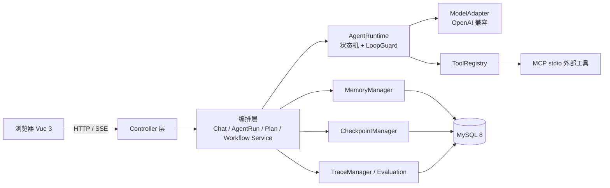

# AgentForge

> 可观测的智能体运行时与任务编排平台。面向学习与面试场景的个人项目，**不是生产级系统**。

以「模型只提出决策，Runtime 负责执行控制」为核心设计：统一模型适配层接入 OpenAI 兼容大模型 API，自研 Agent Runtime 实现结构化决策、工具调用与六类终止条件；在此之上构建任务规划、多角色协作、DAG 调度、上下文记忆、检查点恢复、MCP 外部工具、执行链路追踪与评测能力，配套 Vue 3 前端提供流式对话与执行过程可视化。

## 技术栈

| 层次 | 选型 |
|---|---|
| 后端 | Java 17 · Spring Boot 3.5.6 · MyBatis-Plus 3.5.12 · Spring Boot Actuator |
| 存储 | MySQL 8（12 张表，完整脚本见 `sql/init.sql`） |
| 前端 | Vue 3 · TypeScript · Vite · Element Plus · Pinia · Axios · markdown-it |
| 外部工具 | MCP JSON-RPC 2.0 over stdio（Node 进程） |
| 测试 / 部署 | JUnit 5 + Mockito · Docker Compose · Nginx |

## 架构



分层约定：Controller 只做参数校验与转发；Service 负责业务编排；Runtime 独立于 Controller 与具体厂商 SDK；跨模块能力通过 `ModelAdapter` / `ToolExecutor` / `NodeExecutor` / `MemoryManager` 等接口隔离。

## 快速开始

### 前置条件

- JDK 17、Node.js 18+、MySQL 8
- Maven Wrapper：仓库只提交 `.mvn/wrapper/maven-wrapper.properties`，**首次执行 `mvnw` 会联网下载 wrapper jar**
- 一个可用的 OpenAI 兼容大模型 API（配置见下）

### 1. 配置环境变量

复制 `.env.example` 为 `.env` 填写，或直接在当前终端导出。`.env` 已被 `.gitignore` 忽略，**不要提交真实密钥**。

```powershell

$env:DB_HOST = "localhost"
$env:DB_PORT = "3306"
$env:DB_NAME = "agentforge"
$env:DB_USERNAME = "root"
$env:DB_PASSWORD = "<你的数据库密码>"

$env:MODEL_PROVIDER = "qianwen"
$env:QIANWEN_API_KEY = "<你的 API Key>"


$env:MCP_ENABLED = "false"
```

模型切换只改 `MODEL_PROVIDER`（可选 `qianwen` / `amd` / `deepseek` / `openai` / `ollama`），业务代码零改动。

### 2. 初始化数据库

脚本已包含 `CREATE DATABASE IF NOT EXISTS agentforge`，无需预先建库。

```bash
mysql -uroot -p --default-character-set=utf8mb4 < sql/init.sql
```

Windows PowerShell 可通过 `cmd /c "mysql -uroot -p --default-character-set=utf8mb4 < sql\init.sql"` 执行。

### 3. 启动后端

```powershell
.\mvnw.cmd spring-boot:run

.\mvnw.cmd -DskipTests package
java -jar .\target\AgentForge-0.0.1-SNAPSHOT.jar
```

macOS / Linux 使用 `./mvnw`。服务监听 `8080`，健康检查：`GET /actuator/health`。

### 4. 启动前端

```powershell
cd frontend
npm install
npm run dev
```

打开 `http://localhost:5173`。Vite 已将 `/api` 代理到 `http://localhost:8080`。

### 5. 验证

```powershell
Invoke-RestMethod http://localhost:8080/api/tools
Invoke-RestMethod -Uri http://localhost:8080/api/chat/completions -Method Post `
  -ContentType 'application/json' -Body '{"message":"用一句话介绍你自己"}'
```

> Windows PowerShell 5.1 会用系统 ANSI 编码发送 `-Body`、按 Latin-1 解码响应，中文可能乱码；请用 UTF-8 字节数组或 `curl.exe --data-binary` 验证，这不是后端缺陷。

## 核心能力

| 阶段 | 关键实现 | 代表入口 |
|---|---|---|
| 1 基础链路 | 会话/消息持久化、SSE 流式输出、统一事件契约 | `/api/chat/*` |
| 2 Agent Runtime | `AgentContext` 状态机、`LoopGuard` 六类终止条件、结构化决策与回灌修复 | `/api/agent/runs` |
| 3 Tool Registry | 统一 `Tool` 接口、Schema 校验、两级权限、线程池超时、调用日志 | `/api/tools` |
| 4 Planner | 结构化计划 JSON、依赖校验、环检测与拓扑排序、非法输出修复 | `/api/plans` |
| 5 Multi-Agent | `AgentManager` 角色配置、子任务委派、结果整合 | `/api/agents` |
| 6 DAG Workflow | 8 态节点状态机、同层并行 + 层间屏障、失败传播 | `/api/workflows/*` |
| 7 Memory | 字符预算裁剪、历史摘要落库、按 Agent 隔离工作记忆、任务结果复用 | `/api/memory/*` |
| 8 Checkpoint | 版本化快照、幂等台账、恢复执行不重放工具副作用、节点重试、协作式取消 | `/api/workflows/runs/*` |
| 9 MCP | `StdioMcpTransport` 真实子进程、工具发现/适配/权限控制 | `/api/mcp/*` |
| 10 Trace / Evaluation | 统一事件落库、按 Run/会话查询、指标聚合、固定任务集可解释评分、模型质量对比 | `/api/trace/*`、`/api/evaluation/*` |
| 加分项 | Actuator 健康检查、Dockerfile 多阶段构建、Docker Compose + Nginx（SSE 关闭代理缓冲） | `/actuator/health` |

## 测试与构建

```powershell
.\mvnw.cmd test                     # 163 个单元测试
cd frontend; npm run build          # TypeScript 类型检查 + 生产构建
docker compose config --quiet       # 校验编排文件
```

容器部署（先构建前端静态资源）：

```powershell
cd frontend; npm run build; cd ..
docker compose up -d --build
```

Compose 会启动 MySQL 8（自动执行 `sql/init.sql`）、后端与 Nginx 前端；密钥通过环境变量注入，`docker/nginx.conf` 中 `proxy_buffering off` 是 SSE 正常工作的必要配置。

## 设计与取舍

- **不引入 Spring AI**：Runtime 的终止条件、Token 预算与 Trace 统计依赖协议细节（`finish_reason` / `usage` / SSE 分块 / HTTP 错误码），框架封装会模糊 Runtime 职责边界；`ModelAdapter` 接口保留后续接入能力。
- **Runtime 非流式**：每轮需完整 JSON 决策才能用 Jackson 解析，最终答案一次性推送；基础聊天链路仍为流式。这是结构化决策与流式输出的取舍。
- **SSE 用 POST + fetch**：`EventSource` 不支持请求体与自定义 header；客户端按空行切帧解析 `data:` 行，并支持 `AbortController` 取消。
- **DAG 分层屏障**：同层并行、层间 `allOf` 等待，实现简单可靠，但存在 head-of-line 阻塞；「完成即触发」是后续优化方向。
- **恢复才幂等**：正常执行不去重（同一工具可能被有意多次调用），仅恢复时查 `ExecutionLedger` 复用已完成节点结果，避免重放工具副作用。
- **Evaluation 不新增表**：模型/Token/工具/耗时/失败原因数据已存在于 `chat_message`、`tool_call`、`execution_event`、`workflow_run`，离线聚合即可。

## 已知边界

- 单体分层、本地部署，无压测数据、无真实流量，未做用户体系与权限管理、CI/CD、监控告警。
- Function Calling 为 JSON 决策协议模拟，非原生 `tool_calls`；Runtime / Planner 链路非流式。
- Checkpoint 恢复主要覆盖工作流 Run；节点重试对有副作用工具应在工具层进一步幂等拦截。
- MCP 仅实现 stdio 传输，示例 Server 是随项目提供的最小合规实现，非第三方生产服务。
- Evaluation 提供固定任务集与对历史 Run 的可解释评分，未自动批量执行任务集；事件查询有 `LIMIT` 上限，未做分页与采样压缩。

## 目录结构

```
src/main/java/com/example/agentforge/
├── agent/        角色管理          ├── chat/       会话与基础聊天
├── common/       统一响应与事件    ├── config/     配置属性
├── controller/   REST 端点         ├── evaluation/ 评测服务
├── mcp/          MCP 传输与适配    ├── memory/     上下文管理
├── model/        模型适配层        ├── planner/    任务规划与执行
├── runtime/      Agent Runtime     ├── tool/       工具注册中心
├── trace/        事件持久化        ├── workflow/   DAG 调度与检查点
└── checkpoint/   快照模型
src/main/resources/application.yml     sql/init.sql
frontend/src/{api,stores,types.ts,App.vue}
mcp/echo-server.mjs   Dockerfile   docker-compose.yml   docker/nginx.conf
```

## 安全说明

- 所有密钥、数据库口令均通过环境变量注入，`application.yml` 与 `docker-compose.yml` 只含 `${...}` 占位符；仓库只提交 `.env.example`。
- 上传 Public 仓库前请轮换曾在本机使用过的 API Key，并开启 GitHub Secret Scanning / Push Protection。
- 不要提交 `.env`、`target/`、`frontend/node_modules/`、`frontend/dist/` 或本地日志。
